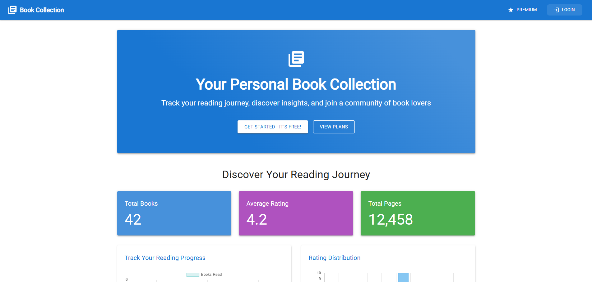

# BookCollectionApp



Welcome to **BookCollectionApp** — a full-stack web application that demonstrates my skills in modern software engineering, scalable architecture, and developer best practices.

---

## 🚀 Why This Project Stands Out

- **Enterprise-Ready Architecture:** Modular, maintainable, and scalable codebase with clear separation of concerns (Go backend, React frontend, Dockerized microservices).
- **Premium SaaS Features:** Implements a real-world subscription model (Free & Premium tiers) with Stripe integration, feature gating, and user upgrade flows.
- **Secure Auth & Data:** Robust authentication via Auth0, secure JWT handling, and user data isolation.
- **CI/CD & Quality:** Automated testing, type-checking, and code coverage reporting for both frontend and backend via GitHub Actions and Codecov.
- **Modern UI/UX:** Responsive, accessible, and visually engaging interface using Material UI, with advanced analytics and interactive dashboards.
- **Cloud-Ready:** Containerized with Docker Compose for seamless local development and cloud deployment.

---

## 🏆 What This Project Demonstrates

- **Full-Stack Mastery:** Go (Golang) backend, React (TypeScript) frontend, PostgreSQL, Stripe, Auth0, Docker, and CI/CD pipelines.
- **Real-World SaaS Patterns:** Subscription management, premium feature gating, payment webhooks, and user onboarding.
- **Testing Culture:** Comprehensive unit/integration tests (Jest, Testing Library, Go test), strict coverage thresholds, and automated quality gates.
- **Developer Experience:** Type safety, modular hooks/components, custom theming, and clear documentation.
- **Production Practices:** Health checks, error handling, environment-based configs, and secure secrets management.

---

## ✨ Premium Features (with Stripe Integration)

- **Free Tier:**
  - Book collection management
  - Basic statistics
  - Cover image support
- **Premium Tier ($4.99/month):**
  - Advanced analytics (reading speed, genre insights, completion rates)
  - Reading goals & streaks (customizable)
  - Monthly/annual progress reports
  - Theme customization (exclusive color themes)
  - Priority support
  - Smooth upgrade/downgrade via Stripe

> **See `/docs/premium-features-implementation.md` for a detailed breakdown.**

---

## 🛠️ Technologies & Tools

- **Backend:** Go, GORM, PostgreSQL, Stripe API, Auth0, RESTful API, JWT, chi router
- **Frontend:** React, TypeScript, Material UI, Chart.js, React Query, Auth0 React SDK, Stripe.js
- **DevOps:** Docker, Docker Compose, GitHub Actions, Codecov, NGINX
- **Testing:** Jest, React Testing Library, Go test, TypeScript type-checking

---

## 🖥️ Visual Preview


---

## 🧑‍💻 Getting Started

1. **Clone the repository:**
    ```sh
    git clone https://github.com/yourusername/BookCollectionApp.git
    cd BookCollectionApp
    ```
2. **Set up environment variables:**
    - Create a `.env` file in the root directory with Auth0, Stripe, and database credentials.
3. **Build and run with Docker Compose:**
    ```sh
    docker-compose up --build
    ```
4. **Access the app:**
    - Visit [http://localhost:5000](http://localhost:5000)

---

## 🧪 Code Quality & Coverage

- Frontend: [](https://codecov.io/gh/RyanFloresTT/BookCollectionApp)
- Backend: [](https://codecov.io/gh/RyanFloresTT/BookCollectionApp)
- Automated CI/CD: Linting, type-checking, and tests run on every PR and push ([see workflows](.github/workflows/))

---

## 💡 About Me / Why Hire Me?

I build robust, scalable, and user-focused applications with:
- Deep experience in Go, React, TypeScript, and cloud-native tooling
- A passion for clean code, automation, and developer experience
- Real-world SaaS, payments, and authentication expertise
- A proven track record of shipping production-ready, maintainable software

**Let’s build something great together!**

---

Thank you for checking out BookCollectionApp! If you have questions or want to discuss opportunities, feel free to reach out.
